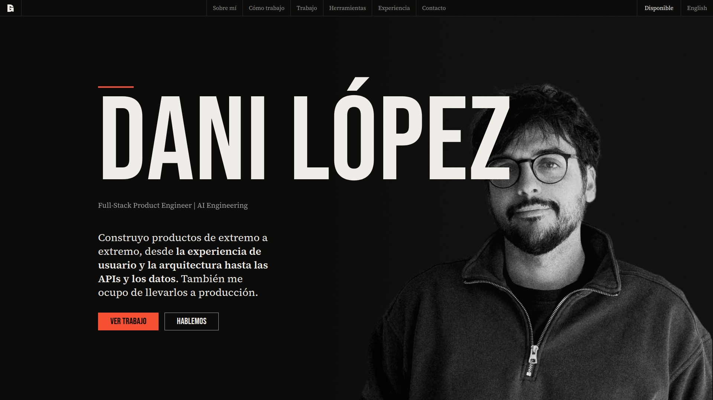

# Portfolio — Dani López González

> Product Engineer · Frontend & AI Engineering.
>
> Sistemas donde la arquitectura y la experiencia se diseñan juntas.



Stack: Next.js 16 · TypeScript · Tailwind CSS · GSAP

## Arrancar

```bash
npm install
cp .env.local.example .env.local
# rellenar RESEND_API_KEY, FROM_EMAIL y CONTACT_EMAIL
npm run dev
```

## Dependencias externas (mínimas y justificadas)

| Paquete                   | Por qué                                              |
| ------------------------- | ---------------------------------------------------- |
| `@radix-ui/react-label`   | `<Label>` accesible con `htmlFor` y ARIA correctos   |
| `sonner`                  | Toast de feedback del formulario                     |
| `clsx` + `tailwind-merge` | `cn()` helper para clases condicionales              |
| `zod`                     | Validación del formulario de contacto                |
| `gray-matter`             | Leer metadatos de las fichas Markdown de trayectoria |
| `react-hook-form`         | Gestión de estado y errores del formulario           |
| `resend`                  | Envío de emails desde el API route                   |
| `@react-email/*`          | Template HTML del email de contacto                  |

Todo lo demás es vanilla — sin shadcn, sin component libraries.

## Trayectoria profesional mantenible

La trayectoria completa se mantiene en [`content/career/`](content/career/README.md) como Markdown editable. Las fichas con `featured: true` alimentan las experiencias ES/EN de la home y, junto al perfil y los proyectos, generan el endpoint público `/career.md`.

La home conserva su selección breve y ofrece solo un enlace discreto a **Trayectoria completa (.md)**. `/llms.txt` sirve como índice para agentes que descubran el sitio; no hay una página HTML adicional.

## Estructura

```
src/
├── app/
│   ├── layout.tsx              # fuentes, Toaster global
│   ├── page.tsx
│   ├── globals.css
│   ├── opengraph-image.tsx
│   ├── sitemap.ts
│   ├── robots.ts
│   ├── enlaces/page.tsx        # página de links (bio link)
│   └── api/contact/route.ts    # Resend
├── components/
│   ├── layout/
│   │   ├── Navbar.tsx
│   │   └── Footer.tsx
│   ├── sections/
│   │   ├── Hero.tsx
│   │   ├── About.tsx
│   │   ├── Skills.tsx
│   │   ├── Projects.tsx        # datos desde lib/projects.ts
│   │   └── Contact.tsx         # react-hook-form + zod + Sonner
│   └── ui/
│       ├── Ticker.tsx
│       ├── CursorDot.tsx
│       ├── RevealOnScroll.tsx
│       ├── Label.tsx           # Radix Label
│       └── Toaster.tsx         # Sonner con tokens del diseño
├── emails/
│   └── ContactEmail.tsx        # template React Email
└── lib/
    ├── utils.ts                # cn()
    ├── projects.ts
    ├── skills.ts
    ├── rate-limit.ts
    └── schemas/contact.ts      # schema Zod compartido
```

## About this project

Personal portfolio built by **Dani López González** ([@danilopgon](https://github.com/danilopgon)), full-stack Product Engineer specialised in frontend, based in Cuenca, Spain.

Designed with a brutalist aesthetic and built without component libraries: every element is intentional. The project presents work across React, Next.js, Angular, TypeScript, Node.js, Python/FastAPI and applied AI tooling, while the codebase demonstrates production-grade full-stack architecture: typed forms with Zod + React Hook Form, scroll-driven animations with GSAP, accessible UI primitives via Radix, and transactional email via Resend and React Email.

Stack: Next.js · TypeScript · Tailwind CSS · GSAP  
Live: [danilopgon.com](https://danilopgon.com)
